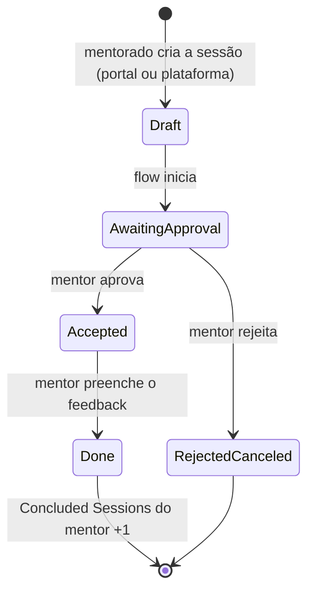

# Mentorship Program · ServiceNow

App ServiceNow que gerencia um programa de mentoria. O mentorado pede uma sessão pelo portal, o mentor aprova, registra o feedback, e o sistema conta as sessões concluídas. Nenhum status é alterado à mão.

Desenvolvido durante o bootcamp **Shark in ServiceNow #14** (Aoop / NTT DATA), em outubro de 2026, numa PDI com a release **Australia**.

- **Escopo:** `x_2280925_mentor_0`
- **Versionamento:** integração nativa de Source Control da ServiceNow Studio com o GitHub

---

## Ciclo de vida de uma sessão

Só dois momentos dependem de pessoas: a aprovação e o feedback. O resto é automatizado.

---

## Modelo de dados

| Tabela | Prefixo | Base | Papel |
|---|---|---|---|
| **Mentor** (`x_2280925_mentor_0_mentor`) | `MEN` | nenhuma | Cadastro do mentor: usuário, biografia, área de atuação, disponibilidade e contador de sessões concluídas |
| **Mentorship Session** (`x_2280925_mentor_0_mentorship_session`) | `MSS` | **Task** | A sessão de mentoria, com ciclo de vida, aprovação e feedback |

Decisões principais:

- **Session estende Task.** Herda número, state, responsável, comentários, work notes e a integração com aprovações. É herança de classe: `class MentorshipSession extends Task`.
- **States próprios** (Draft, Awaiting approval, Accepted, Done, Rejected/Canceled) criados só na tabela filha, com **Dictionary Override** definindo Draft como padrão. Isso não altera a Task nem as outras tabelas que a estendem.
- **Mentor's Name** é uma Reference para Mentor (chave estrangeira), com **reference qualifier** `Available = true`: só aparecem mentores disponíveis.
- **Related list** de sessões dentro do mentor e lista de **Approvers** na sessão.

---

## Segurança

| Grupo | Roles |
|---|---|
| Mentorship Program - Mentorados | `x_2280925_mentor_0.mentee` |
| Mentorship Program - Mentores | `x_2280925_mentor_0.mentor` + `approver_user` |

ACLs de tabela e de campo garantem que:

- o mentorado só edita as sessões que ele abriu (`Opened by is (dynamic) Me`);
- o **Session Feedback** só pode ser escrito pelo mentor;
- o mentor só edita o próprio cadastro (`Name is (dynamic) Me`).

Os módulos do menu são exibidos por role, mas quem protege o dado de verdade são as ACLs. Tudo foi testado com *Impersonate*.

---

## Automação: Mentorship Session Workflow (Flow Designer)

**Trigger:** Record Created na Mentorship Session · **Run As:** System User

1. State → **Awaiting approval**
2. **Ask For Approval**: o aprovador é o mentor escolhido (dot-walk sessão → mentor → usuário)
3. Rejeitada → State **Rejected/Canceled** e fim
4. Aprovada → State **Accepted**
5. **Wait For Condition**: aguarda o Session Feedback ser preenchido
6. State → **Done**
7. **Concluded Sessions** do mentor + 1

---

## Portal (Employee Center)

- **Record Producer** "Mentorship Session": formulário simplificado que grava direto na tabela de sessões. Por isso o flow e as ACLs continuam valendo.
- **User Criteria**: o item só aparece para membros dos grupos do programa.
- **Menu item** "New Mentorship Session" no Employee Center, exibido por condição de role (`gs.hasRole()`).

---

## Experiência no formulário

- **UI Policies:** campos obrigatórios e Session Feedback visível só depois que a sessão é aceita.
- **Process Flow:** barra de fases no topo do formulário, destacando o state atual.

---

## Como instalar numa instância

O app foi exportado pela integração de Source Control. Para importá-lo numa instância de desenvolvimento (não produção):

1. Crie uma credencial **Basic Auth** com seu usuário do GitHub e um Personal Access Token com escopo `repo`.
2. Na **ServiceNow Studio**, use a opção de importar app a partir do Source Control.
3. Informe a URL deste repositório e a credencial.

> O branch `sn_instances/dev411907` é o branch de trabalho da instância de origem. O `main` guarda a versão publicada.

---

## Autora

**Amanda Galvão** · desenvolvedora front-end (JavaScript, TypeScript, React, Vue, Node.js)
[github.com/amandarga](https://github.com/amandarga)
